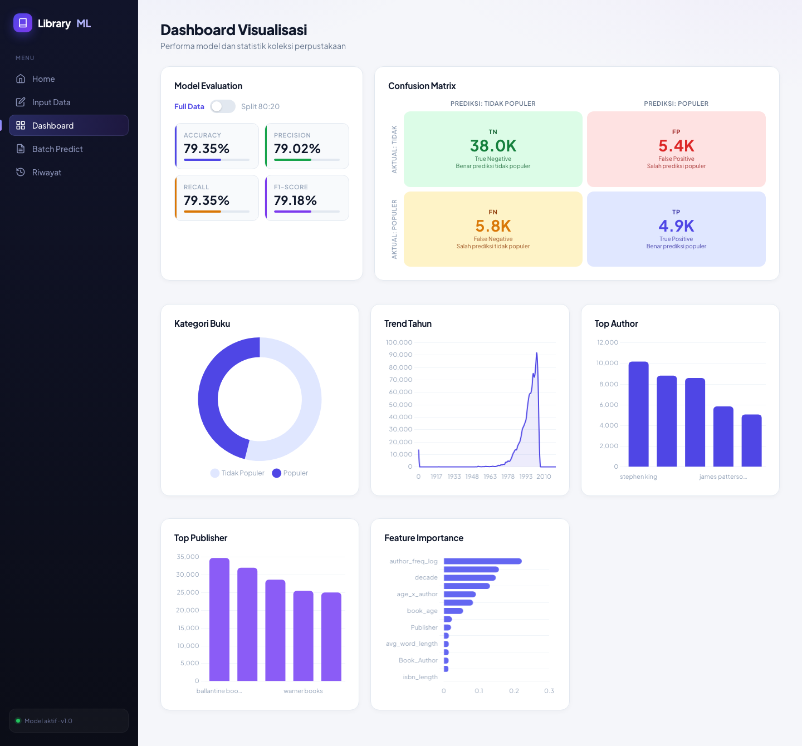
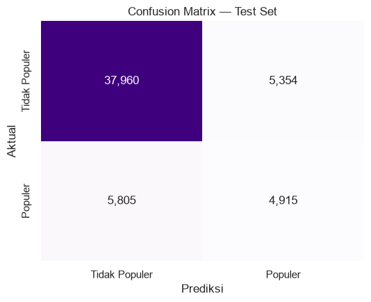
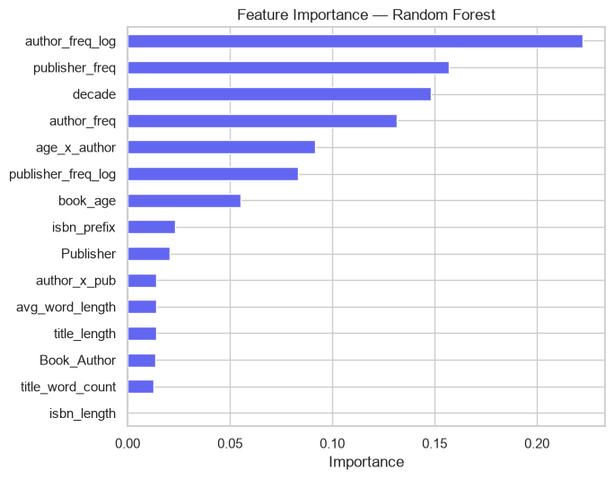
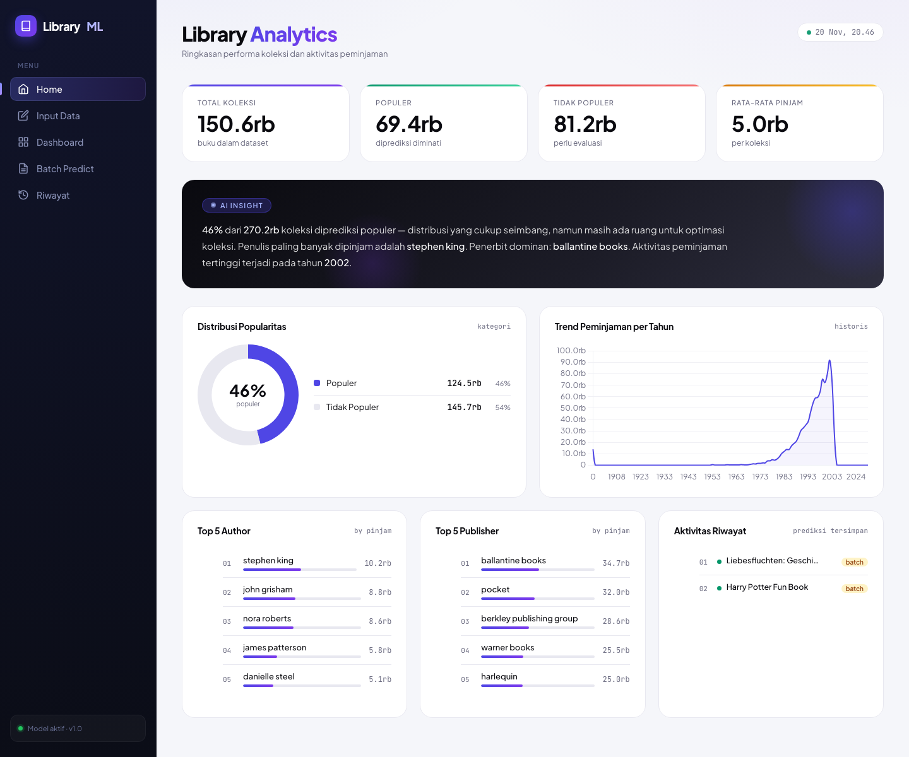
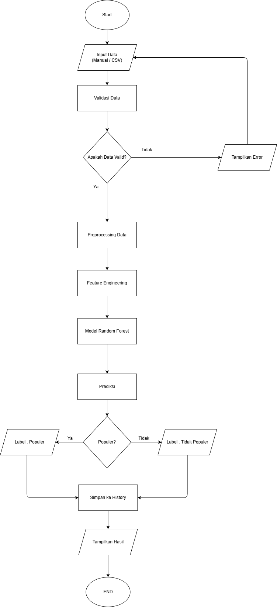

# Prediksi Popularitas Buku Perpustakaan Menggunakan Random Forest

**Penulisan Ilmiah** · Machine Learning dengan metodologi CRISP-DM dan dashboard web berbasis Flask

| | |
|---|---|
| **Penulis** | Baskara Kresna Juniarto — 50423260 |
| **Program Studi** | Informatika, Fakultas Teknologi Industri |
| **Universitas** | Universitas Gunadarma |
| **Dosen Pembimbing** | Dini Triasanti, ST., MMSI. |
| **Tahun** | 2026 |



---

## Ringkasan

Penelitian ini membangun model klasifikasi untuk memprediksi apakah sebuah buku termasuk
**populer** atau **tidak populer** berdasarkan atribut bibliografinya (penulis, penerbit,
tahun terbit, judul, dan ISBN). Data yang digunakan adalah **Book-Crossing Dataset**
yang diolah menjadi **270.170 judul buku**. Sebuah buku diberi label populer jika jumlah
interaksinya berada di atas kuartil ketiga (Q75).

Model **Random Forest** dilatih dengan 15 fitur hasil *feature engineering*. Ketidakseimbangan kelas
(80% : 20%) ditangani dengan **SMOTE**, divalidasi dengan **Stratified 5-Fold Cross Validation**,
dan *threshold* keputusan dioptimalkan dengan prediksi *out-of-fold*. Pada data uji (20%), model
mencapai **akurasi 79,35%**, **F1-Score (weighted) 79,18%**, **F1 Macro 67,01%**, dan
**AUC-ROC 0,7757**. Model kemudian diterapkan pada dashboard web untuk prediksi tunggal,
prediksi massal (CSV), visualisasi, dan riwayat prediksi.

---

## Daftar Isi

1. [Tujuan Penelitian](#tujuan-penelitian)
2. [Dataset](#dataset)
3. [Metodologi CRISP-DM](#metodologi-crisp-dm)
4. [Hasil Penelitian](#hasil-penelitian)
5. [Aplikasi Dashboard](#aplikasi-dashboard)
6. [Cara Menjalankan](#cara-menjalankan)
7. [Struktur Proyek](#struktur-proyek)
8. [Keterbatasan dan Saran](#keterbatasan-dan-saran)
9. [Referensi](#referensi)

---

## Tujuan Penelitian

1. Menerapkan metodologi CRISP-DM untuk membangun model prediksi popularitas buku.
2. Mengukur performa algoritma Random Forest dalam mengklasifikasikan buku populer dan tidak populer pada data yang tidak seimbang.
3. Mengidentifikasi fitur yang paling berpengaruh terhadap popularitas buku.
4. Menyajikan model dalam bentuk aplikasi dashboard yang dapat digunakan untuk prediksi dan analisis koleksi.

---

## Dataset

Sumber data adalah **Book-Crossing Dataset** (Ziegler dkk., 2005) yang terdiri dari tiga file:

| File | Isi |
|---|---|
| `data/Books.csv` | Data bibliografi: ISBN, judul, penulis, tahun terbit, penerbit |
| `data/Ratings.csv` | Interaksi pengguna dengan buku (rating) |
| `data/Users.csv` | Data pengguna |

`Books.csv` dan `Ratings.csv` digabung berdasarkan ISBN, lalu diagregasi per buku
(`scripts/prepare_dataset.py`). Hasilnya adalah `data/dataset.csv` dengan **270.170 baris**.

> **Catatan:** variabel `jumlah_pinjam` dihitung dari **jumlah interaksi/rating per ISBN**
> dan digunakan sebagai *proxy* (pendekatan) dari jumlah peminjaman buku.

**Pelabelan target** — buku diberi label **Populer (1)** jika `jumlah_pinjam` > Q75 (= 3):

| Kelas | Jumlah | Persentase |
|---|---:|---:|
| Tidak Populer (0) | 216.571 | 80,2% |
| Populer (1) | 53.599 | 19,8% |

---

## Metodologi CRISP-DM

| Tahap | Kegiatan | File |
|---|---|---|
| **1. Business Understanding** | Merumuskan masalah: memprediksi buku yang berpotensi diminati agar pengelolaan koleksi lebih tepat sasaran | — |
| **2. Data Understanding** | Eksplorasi struktur data, statistik deskriptif, *missing value*, distribusi | `scripts/crispdm/data_understanding.py` |
| **3. Data Preparation** | *Merge*, pembersihan teks, agregasi per ISBN, pelabelan Q75, *encoding*, *feature engineering* | `scripts/prepare_dataset.py`, `scripts/crispdm/data_preparation.py` |
| **4. Modeling** | Random Forest + SMOTE, Stratified 5-Fold CV, *threshold tuning* | `notebooks/train_model.ipynb` |
| **5. Evaluation** | Accuracy, Precision, Recall, F1, AUC-ROC, Confusion Matrix pada data uji | `notebooks/train_model.ipynb` |
| **6. Deployment** | Dashboard web Flask untuk prediksi dan visualisasi | `app.py`, `templates/` |

### Feature Engineering (15 fitur)

| Kelompok | Fitur | Keterangan |
|---|---|---|
| Identitas | `Book_Author`, `Publisher` | *Label encoding* penulis dan penerbit |
| Usia buku | `book_age`, `decade` | Umur buku (2025 − tahun terbit) dan dekadenya |
| Judul | `title_length`, `title_word_count`, `avg_word_length` | Panjang dan kompleksitas judul |
| ISBN | `isbn_length`, `isbn_prefix` | Format ISBN (10/13) dan kode kelompok bahasa/negara |
| Frekuensi | `author_freq`, `publisher_freq`, `author_freq_log`, `publisher_freq_log` | Produktivitas penulis/penerbit (dihitung **hanya dari data latih**) |
| Interaksi | `author_x_pub`, `age_x_author` | Kombinasi antar fitur |

### Desain Eksperimen

- **Pembagian data:** 80% latih, 20% uji (*stratified*, `random_state=42`).
- **Pencegahan *data leakage*:** fitur frekuensi dihitung dari data latih saja; SMOTE diterapkan **di dalam** setiap *fold* cross validation melalui `imblearn.Pipeline`.
- **Penyeimbangan kelas:** SMOTE pada data latih (173.257 : 42.879 → 173.257 : 173.257).
- **Model:** `RandomForestClassifier(n_estimators=200, max_depth=15, min_samples_split=4, min_samples_leaf=2, max_features='sqrt', class_weight='balanced_subsample')`.
- **Threshold tuning:** dipilih dari rentang 0,25–0,65 berdasarkan F1 Macro prediksi *out-of-fold* (bukan data uji) → **threshold optimal 0,55**.

---

## Hasil Penelitian

### Stratified 5-Fold Cross Validation

| Fold | Accuracy | Precision | Recall | F1-Score |
|---|---:|---:|---:|---:|
| 1 | 77,38% | 79,04% | 77,38% | 78,09% |
| 2 | 77,66% | 79,18% | 77,66% | 78,32% |
| 3 | 77,61% | 79,29% | 77,61% | 78,33% |
| 4 | 77,75% | 79,24% | 77,75% | 78,40% |
| 5 | 77,57% | 79,19% | 77,57% | 78,27% |
| **Rata-rata** | **77,59%** | **79,19%** | **77,59%** | **78,28%** |

Simpangan baku F1 antar *fold* hanya **0,12%**, sehingga performa model stabil.

### Evaluasi pada Data Uji (54.034 buku)

| Metrik | Nilai |
|---|---:|
| Accuracy | **79,35%** |
| Precision (weighted) | 79,02% |
| Recall (weighted) | 79,35% |
| F1-Score (weighted) | 79,18% |
| F1-Score (macro) | 67,01% |
| F1 Kelas Tidak Populer | 87,19% |
| F1 Kelas Populer | 46,83% |
| AUC-ROC | 0,7757 |

<p align="center">
  
  
</p>

|  | Prediksi Tidak Populer | Prediksi Populer |
|---|---:|---:|
| **Aktual Tidak Populer** | 37.960 (TN) | 5.354 (FP) |
| **Aktual Populer** | 5.805 (FN) | 4.915 (TP) |

### Pembahasan

- **Fitur paling berpengaruh** adalah popularitas penulis (`author_freq_log`, 22,2%), produktivitas penerbit (`publisher_freq`, 15,7%), dan era terbit (`decade`, 14,8%). Artinya, **siapa penulis dan penerbitnya** lebih menentukan popularitas buku daripada karakteristik judul.
- Model **sangat baik mengenali buku tidak populer** (F1 87,19%), tetapi **masih terbatas pada buku populer** (F1 46,83%). Hal ini wajar karena kelas populer hanya 19,8% dari data dan atribut bibliografi tidak memuat informasi isi buku.
- Karena data tidak seimbang, **F1 Macro (67,01%) dan AUC-ROC (0,7757)** lebih representatif daripada akurasi untuk menilai kemampuan model secara keseluruhan.

---

## Aplikasi Dashboard



| Halaman | Fungsi |
|---|---|
| **Home** | Ringkasan koleksi: KPI, *insight* otomatis, distribusi popularitas, tren per tahun, top penulis/penerbit |
| **Input Data** | Mencatat data peminjaman baru dan mengunduhnya sebagai CSV |
| **Dashboard** | Evaluasi model (metrik & confusion matrix) dan visualisasi data |
| **Batch Predict** | Unggah CSV untuk memprediksi banyak buku sekaligus |
| **Riwayat** | Log seluruh prediksi dengan pencarian, filter, dan ekspor CSV |

Prediksi di aplikasi menggunakan *threshold* 0,55 yang sama dengan hasil evaluasi.

### Alur Sistem Prediksi

<p align="center"></p>

---

## Cara Menjalankan

**Kebutuhan:** Python 3.13

```bash
# 1. Buat environment dan pasang library (sekali saja)
python3 -m venv .venv
.venv/bin/pip install -r requirements.txt

# 2. Jalankan dashboard
./run.sh                # macOS / Linux
run.bat                 # Windows
```

Buka **http://localhost:5001** di browser. Tekan `Ctrl + C` di Terminal untuk berhenti.

**Training ulang model:** buka `notebooks/train_model.ipynb` lalu jalankan semua sel, atau
`.venv/bin/python scripts/train_model.py`. Model tersimpan di `models/model.pkl`.

**Teknologi:** Python · pandas · NumPy · scikit-learn · imbalanced-learn · Flask · Chart.js · Jupyter

---

## Struktur Proyek

```
library-ml-dashboard/
├── app.py                  # Aplikasi web Flask
├── utils.py                # Validasi input & pembentukan fitur
├── run.sh / run.bat        # Menjalankan aplikasi
├── requirements.txt        # Daftar library
├── templates/ · static/    # Tampilan web
├── data/                   # Dataset mentah, dataset olahan, riwayat prediksi
├── models/                 # model.pkl hasil training
├── notebooks/              # train_model.ipynb (Modeling & Evaluation)
├── scripts/                # prepare_dataset, train_model, visualisasi, crispdm/
├── output/                 # Grafik & hasil 5-fold cross validation
├── logs/                   # Log aplikasi & training
└── docs/                   # Flowchart & gambar README
```

---

## Keterbatasan dan Saran

**Keterbatasan**
1. `jumlah_pinjam` merupakan *proxy* dari jumlah rating, bukan data peminjaman perpustakaan yang sebenarnya.
2. Kemampuan model mengenali buku populer masih rendah (F1 kelas populer 46,83%).
3. Fitur hanya berasal dari metadata bibliografi, tanpa informasi isi, genre, atau sinopsis.

**Saran penelitian selanjutnya**
1. Menggunakan data transaksi peminjaman asli dari perpustakaan.
2. Menambahkan fitur genre/kategori, sinopsis (NLP), atau data demografi pengguna.
3. Membandingkan dengan algoritma lain seperti XGBoost, LightGBM, atau Logistic Regression.
4. Melakukan *hyperparameter tuning* sistematis (Grid/Random Search).

---

## Referensi

- Ziegler, C.-N., McNee, S. M., Konstan, J. A., & Lausen, G. (2005). *Improving Recommendation Lists Through Topic Diversification*. Proceedings of the 14th International World Wide Web Conference (WWW '05). — sumber Book-Crossing Dataset.
- Breiman, L. (2001). Random Forests. *Machine Learning*, 45(1), 5–32.
- Chawla, N. V., Bowyer, K. W., Hall, L. O., & Kegelmeyer, W. P. (2002). SMOTE: Synthetic Minority Over-sampling Technique. *Journal of Artificial Intelligence Research*, 16, 321–357.
- Wirth, R., & Hipp, J. (2000). CRISP-DM: Towards a Standard Process Model for Data Mining. *Proceedings of the 4th International Conference on the Practical Applications of Knowledge Discovery and Data Mining*.

---

<sub>Dibuat sebagai Penulisan Ilmiah. Hasil angka di atas berasal dari eksekusi `notebooks/train_model.ipynb`.</sub>
